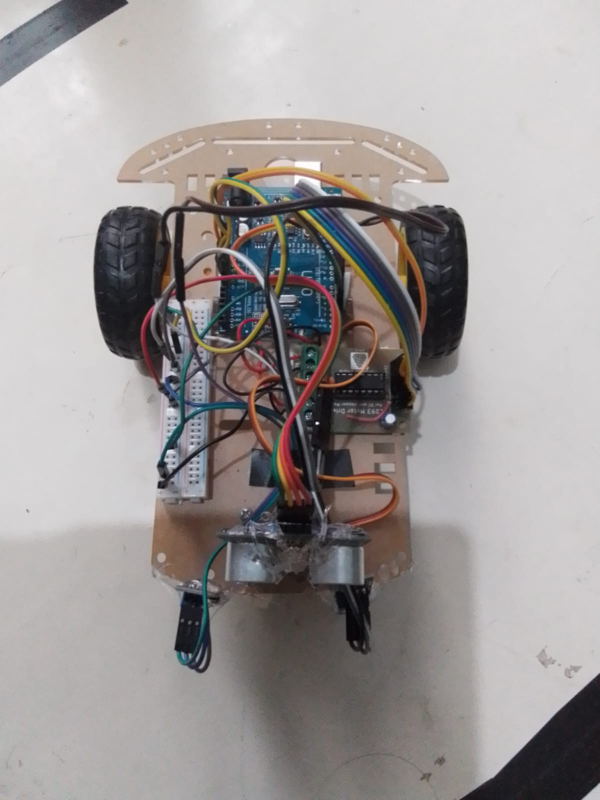

# 🤖 Line Following Robot with Obstacle Detection

## 📌 Project Overview
This project is an Arduino-based autonomous robot designed to follow a predefined path using IR sensors. It also detects obstacles using an ultrasonic sensor and performs obstacle avoidance.

## 🎯 Problem Statement
To develop an autonomous robot that can follow a specified path and detect obstacles, demonstrating the practical applications of embedded systems and robotics.

## 🛠️ Hardware Components
- Arduino Uno
- IR Sensors
- HC-SR04 Ultrasonic Sensor
- Servo Motor
- L298N Motor Driver
- 2 DC Gear Motors
- 16×2 LCD Display
- Breadboard
- Jumper Wires
- Robot Chassis

## 💻 Software Requirements
- Arduino IDE
- Embedded C/C++
- Arduino Libraries: Servo and LiquidCrystal_I2C

## ⚙️ Working Principle
1. IR sensors detect the predefined path.
2. Arduino processes the sensor signals.
3. The L298N motor driver controls the DC motors.
4. The ultrasonic sensor measures the distance from obstacles.
5. The servo motor helps scan the surrounding area.
6. The LCD displays relevant system information.

## ✨ Key Features
- Automatic line following
- Obstacle detection
- Obstacle avoidance
- Dual motor control
- Real-time status display

## 🔮 Future Scope
- Improved navigation accuracy
- Advanced sensor integration
- Wireless monitoring
- Smarter obstacle detection

## 👩‍💻 Project Information
**Project:** Line Following Robot with Obstacle Detection  
**Controller:** Arduino Uno  
**Programming Language:** Arduino C/C++  
**Category:** Robotics and Embedded Systems

---

*This project demonstrates the integration of electronics, embedded programming, and automation.*

## 📸 Project Gallery

## 🎥 Project Demonstration

[Watch Robot Demonstration](robot-demonstration.mp4)
